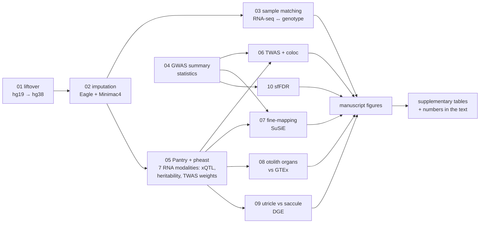

# The genetics of functional decline in the aging vestibular system

The genetics of functional decline in the aging vestibular system: GWAS of dizziness (UKB + MVP) integrated with
multimodal RNA-seq of human otolith organs (utricle and saccule, 107 donors): xQTL mapping across seven RNA
modalities (Pantry), TWAS and colocalisation, fine-mapping, and otolith-vs-GTEx expression.

## Workflow

Each box is one analysis folder with its own Snakefile; the main `Snakefile` runs them in this order
(redundant edges removed).



## Layout

```
Snakefile            main workflow: analyses in order, then figures and tables
config/              config.yaml (shared paths + parameters; site-specific paths in config_lab.yaml, not in git)
profiles/slurm/      Snakemake Slurm profile (set your account and partitions)
run_pipeline.slurm   Slurm controller job; arguments go to snakemake
envs/                conda environments used by the pipeline (exported YAML; names as in config.yaml envs)
logs/                run logs
data/                raw inputs: genotype and FASTQ links, GWAS summary statistics in data/gwas_raw_sumstats
                     (received; the meta-analysis, MAGMA, LDSC and GSEM were run elsewhere)
resources/           references used by several analyses/figures: Ensembl 110 genome + GTF, 1000 Genomes LD
                     reference, recombination map, GTEx tissue colours
analyses/
  01_liftover/         genotype merge, liftover hg19 -> hg38
  02_imputation/       phasing (Eagle), imputation (Minimac4, 1000 Genomes phase 3)
  03_sample_matching/  RNA-seq to genotype sample matching (STAR, ASEReadCounter)
  04_gwas_sumstats/    GWAS summary statistics harmonisation, TWAS / LDSC input
  05_pantry/           Pantry phenotyping (7 RNA modalities) + pheast (xQTL, heritability, TWAS weights); RNA editing
                       with the 0/0 fix and host-gene expression regressed out (see analyses/05_pantry/README.md)
  06_twas/             FUSION TWAS + coloc with every GWAS trait, hits, annotation
  07_fine_mapping/     SuSiE fine-mapping of the dizziness loci and the ZNF91 isoform QTL
  08_expression_gtex/  otolith organs vs GTEx expression, vestibular-enriched genes, enrichment
  09_dge/              utricle vs saccule differential expression
  10_sffdr/            sfFDR of the dizziness GWAS (T. Willis; merged with its history from PejLab/sffdr_for_dizziness;
                       own layout, profile and container; see its README)
manuscript/          figures/: paper figures (Snakefile + one folder per figure: code, panels/, source data, final figure);
                     tables/: Supplementary Tables 1 (collaborators' GWAS results, cleaned) and 2, and every number quoted in
                     the text (manuscript_numbers.tsv; code + output); manuscript draft (PDF)
```

Each analysis holds its `Snakefile`, `scripts/`, its own inputs in `src/` (references and sample inputs used only
there), outputs in `results/` and its own plots in `figures/` (Pantry keeps its own layout inside `phenotyping/` and
`pheast/`). Sample sheets (metadata, covariates, sample IDs per tissue) are made by 03 and read from
`analyses/03_sample_matching/results/sample_sheets/`; the FASTQ list is `03/src/path_to_fqs.tsv`, the GWAS trait map
`04/src/gwas_map.tsv`, the 107 analysed individuals `05/src/vestibular_individuals_107.txt`.
Analyses 01-04, 06 and 10 run inside their folder; 07-09, figures and tables run from the project root.

## Running (on a compute node or through Slurm)

1. **Software.** Create the conda environments from `envs/*.yml` (one file per environment; the names are listed under
   `envs:` in `config/config.yaml`). The sfFDR workflow (10) runs its tools in its own container image, which it
   pulls automatically (Apptainer/Singularity needed).
2. **Paths.** `config/config.yaml` lists every setting; values shown as `/path/to/...` depend on your system: where the
   raw data are, references kept outside the project, tool locations, `conda_prefix`, Slurm partitions. Either edit
   them there, or copy only those keys into a new file `config/config_lab.yaml` with your values. That file is not
   tracked by git and, when present, is read after `config.yaml` and overrides it. Put participant identifiers
   (outlier donor IDs, date-of-birth corrections) and your personal NIH LDlink token (`apis: ldlink: token:`, used
   for Fig 2e; request one at https://ldlink.nih.gov/?tab=apiaccess) only in `config_lab.yaml`, never in `config.yaml`.
3. **Slurm.** Set your account and partitions in `profiles/slurm/config.yaml` and `run_pipeline.slurm`.

```bash
sbatch run_pipeline.slurm                                       # everything (controller job; each rule is its own job)
sbatch run_pipeline.slurm 08_expression_gtex                    # one analysis
sbatch run_pipeline.slurm -s manuscript/figures/Snakefile fig3  # one figure
snakemake --profile profiles/slurm -n                           # dry run (environment with Snakemake 9)
```

Files and folders that are not in git (data, references, results, figures) are described by the README.md in each.

## Author

Mehdi Esmaeili-Fard (mehdi.esmaeilifard@gmail.com).  
Completion date: April 2026.
